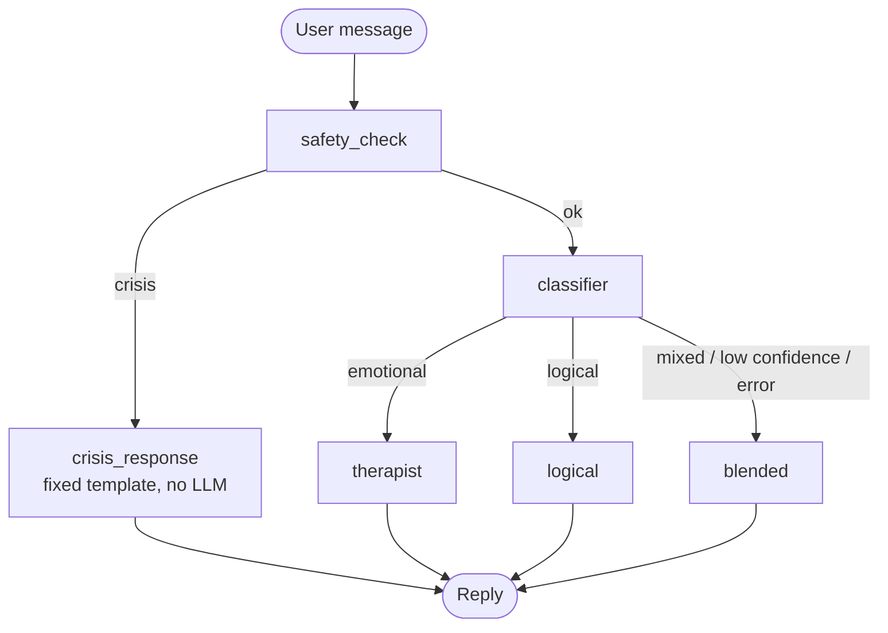

# Head & Heart chatbot

A LangGraph chatbot that decides whether a message needs a **heart** response (emotional support)
or a **head** response (facts and practical help), or both, and routes it to the right agent. It
ships as a CLI and as a streaming HTTP API, with safety checks for crisis messages.

> **Status: pre-release (0.1.0, unreleased).** The code is tested against fake models. It has
> **not** been run against the live Groq API yet, the classifier eval has never run, the Docker
> image has never been built, and the GitHub workflows have never run. See
> [Known limitations](#known-limitations) before relying on it.

> **Not a clinical product.** This is an AI assistant, not a licensed therapist or a medical
> service. See [Safety](#safety).

## How it works



| Node | What it does |
|------|--------------|
| `safety_check` | Regex catches explicit self-harm, abuse and medical-emergency statements. Ambiguous wording is confirmed by an LLM. If that check fails, it assumes a crisis. |
| `crisis_response` | Returns a fixed, region-specific message with hotline details. No LLM is involved. |
| `classifier` | Labels the latest message `emotional`, `logical` or `mixed`, with a confidence score, using the last few turns as context. Below `CLASSIFIER_CONFIDENCE_THRESHOLD`, or on failure, it falls back to `mixed`. |
| `therapist` | Empathetic, asks reflective questions, avoids unsolicited solutions. |
| `logical` | Direct and factual. Briefly acknowledges clear distress. |
| `blended` | Acknowledges the feeling first, then gives practical help. |

Conversation history is checkpointed per `thread_id` and trimmed to a token budget before it is
sent to a model.

## Quick start

Requires Python 3.12+ and [uv](https://docs.astral.sh/uv/).

```bash
uv sync
cp .env.example .env        # then set GROQ_API_KEY
uv run head-and-heart
```

Type `exit` or `quit` to leave. By default the conversation is **not saved**. To keep it:

```bash
PERSIST_HISTORY=true uv run head-and-heart                 # prints a thread id
PERSIST_HISTORY=true uv run head-and-heart --thread-id <id>      # resume
PERSIST_HISTORY=true uv run head-and-heart --delete-thread <id>  # delete
```

## Configuration

Settings come from environment variables or a `.env` file. Only `GROQ_API_KEY` is required for the
CLI. Missing or invalid values fail at startup.

| Variable | Default | Purpose |
|----------|---------|---------|
| `GROQ_API_KEY` | required | Groq API key |
| `LLM_PROVIDER` | `groq` | LLM backend (only `groq` is supported) |
| `MODEL_NAME` | `llama-3.3-70b-versatile` | Model for the response agents |
| `CLASSIFIER_MODEL_NAME` | `llama-3.1-8b-instant` | Model for classification and safety checks |
| `REQUEST_TIMEOUT_S` / `MAX_RETRIES` | `30` / `3` | Per-request timeout and the client's built-in retries |
| `MAX_CONTEXT_TOKENS` | `6000` | Approximate history budget sent to a model |
| `CLASSIFIER_CONFIDENCE_THRESHOLD` | `0.6` | Below this, a message is treated as `mixed` |
| `CRISIS_REGION` | `US` | Region for hotline details (`US`, `CA`, `UK`, `IN`, `AU`, else generic) |
| `MAX_INPUT_CHARS` | `4000` | Longest accepted message |
| `PERSIST_HISTORY` | `false` | Store conversations in SQLite (unencrypted) |
| `CHECKPOINT_DB_PATH` | `chat_history.sqlite` | SQLite file when persisting |
| `LOG_LEVEL` / `LOG_FORMAT` | `INFO` / `text` | `LOG_FORMAT=json` for structured logs |
| `API_KEYS` | empty | HTTP API keys as `user:key,user2:key2` |
| `API_AUTH_DISABLED` | `false` | Local development only |
| `RATE_LIMIT_PER_MINUTE` | `20` | Per-user limit on `/chat` |

The model IDs are defaults chosen from memory and have not been checked against Groq's current
model list. Confirm them, and that the classifier model supports structured output, before use.

## HTTP API

```bash
API_KEYS="alice:$(openssl rand -hex 24)" uv run uvicorn head_and_heart.api:app_factory --factory
```

| Endpoint | Description |
|----------|-------------|
| `POST /chat` | Body `{"message": "...", "thread_id": "optional"}`. Streams Server-Sent Events: `token` (`{"text"}`), then `meta` (`{"crisis": bool}`) and `done` (`{"thread_id"}`), or `error`. Add `"debug": true` to also get `message_type` and `confidence` in `meta`. Needs `X-API-Key`. |
| `DELETE /threads/{thread_id}` | Deletes that user's stored thread. Needs `X-API-Key`. |
| `GET /health` | Liveness. No auth. |
| `GET /metrics` | Prometheus metrics. No auth, so restrict it at the network level. |

```bash
curl -N -X POST localhost:8000/chat \
  -H "X-API-Key: <your key>" -H "content-type: application/json" \
  -d '{"message": "What is the capital of Australia?", "thread_id": "demo"}'
```

Threads are namespaced by user, so one user cannot read another's. The service will not start
without `API_KEYS` unless `API_AUTH_DISABLED=true`.

## Docker

```bash
docker build -t head-and-heart .
docker run --rm -p 8000:8000 -e GROQ_API_KEY=... -e API_KEYS=alice:<key> head-and-heart
```

The image runs as a non-root user, logs JSON, and has a health check. Mount a volume at `/data`
and set `PERSIST_HISTORY=true` to keep conversations. The image has not been built or run yet.

## Demo UI (Streamlit)

A small chat front end for demos and internal testing. It calls the HTTP API, so auth, rate
limits and safety checks all apply. It is **not** meant for real users: Streamlit re-runs the
script on every interaction and does not isolate users, so do not expose it publicly as is.

```bash
uv sync --extra demo
API_KEYS="alice:secret" uv run uvicorn head_and_heart.api:app_factory --factory   # terminal 1
DEMO_API_KEY=secret uv run streamlit run demo/app.py                              # terminal 2
```

It shows the not-a-therapist notice, streams replies, flags crisis replies with an emergency
banner, keeps the conversation in browser-session memory only, and has a "New conversation"
button that also deletes the server-side thread. The sidebar toggle "Show routing details"
displays the classification and confidence. `DEMO_API_URL` and `DEMO_API_KEY` set the defaults.
The UI has only been tested headlessly, not looked at in a browser.

## Development

```bash
uv run ruff check . && uv run ruff format --check .
uv run mypy
uv run pytest --cov=head_and_heart       # fails under 85% coverage
```

Live classifier evaluation calls the real API, so it is opt-in:

```bash
GROQ_API_KEY=... uv run pytest -m eval tests/evals/test_classifier_eval.py -s
```

It reports accuracy, per-class F1 and a confusion matrix over 100 labeled messages, and fails
under 90% accuracy (override with `EVAL_MIN_ACCURACY`). The labels are the author's judgment.

```
src/head_and_heart/
  graph.py        graph assembly and routing
  nodes/          safety, classifier, agents
  prompts.py      versioned system prompts (PROMPT_VERSION)
  crisis.py       fixed crisis messages and hotlines
  api.py          FastAPI service
  cli.py          command-line interface
  observability.py, logging.py   metrics, JSON logs, PII redaction
demo/             optional Streamlit demo UI (extra: `demo`)
tests/            unit, integration, and evals (datasets in tests/evals/)
docs/             plan.md, privacy.md, runbook.md
```

## Safety

- Explicit crisis statements get a fixed reply with no LLM. Ambiguous ones are confirmed by an
  LLM, and a failed check assumes a crisis.
- The regex covers common English phrasing only. Slang, misspellings and other languages can slip
  past it.
- Hotline numbers in `src/head_and_heart/crisis.py` were written from memory. **Verify them for
  every region you support before launch.**
- User text is treated as data in every prompt, but prompt injection is reduced, not prevented.
- Stored conversations are unencrypted plain text. Message text goes to Groq. Read
  [docs/privacy.md](docs/privacy.md) and Groq's terms before any public launch.

## Known limitations

- Never run against live Groq. Model IDs, structured output and classifier accuracy are unverified.
- Docker image unbuilt. GitHub workflows unrun (they need a `GROQ_API_KEY` repo secret).
- Rate limiting is per process. `/metrics` is unauthenticated. No CORS configuration.
- Agent nodes are synchronous, so the API runs model calls in worker threads.
- No automatic data retention or expiry.

See [CHANGELOG.md](CHANGELOG.md) for history and [docs/runbook.md](docs/runbook.md) for operations.
